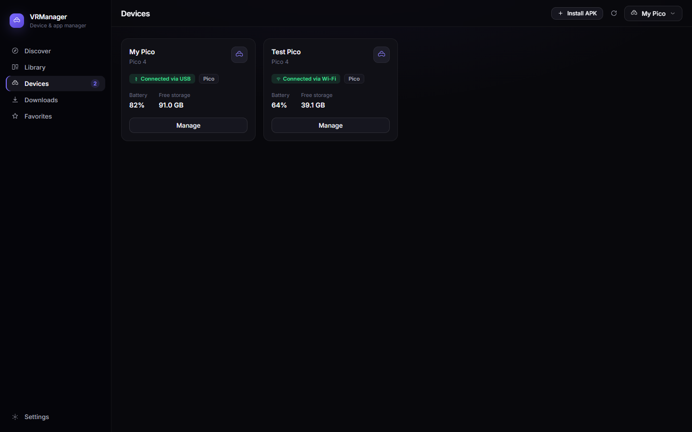
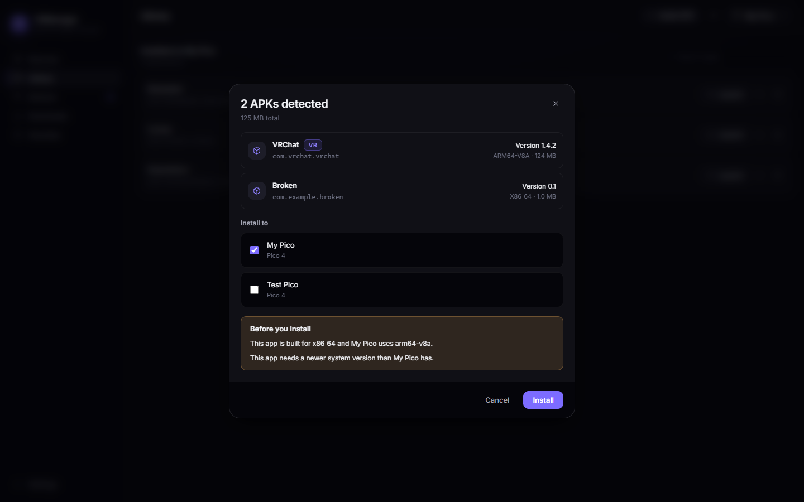

# VRManager Desktop

<p align="center">
  
</p>

**Universal VR App & Device Manager** — connect Pico and Meta Quest headsets,
manage everything installed on them, and install APKs by dragging a file onto
the window.

> One manager for all your VR devices.

| Devices | Installation |
|---|---|
|  |  |

---

## What is this?

A premium desktop client for managing VR headsets over ADB. It is built so the
user never has to think about ADB, transports, ABIs or package managers — those
exist in the product, but behind an *Advanced* surface.

**Works fully offline.** Devices, installed apps, local APK installation,
uninstall, launch, force stop and clear data all function with no backend and
no internet connection. The catalog, reviews and recommendations are the only
features that require the backend, and they degrade gracefully.

---

## Architecture

```
React + TypeScript
      ↓  Tauri commands / ↑ events
commands/ · state/ · events/        (the only Tauri-aware layer)
      ↓
core/devices::DeviceManager          (orchestration, profiles, install queue)
      ↓                ↓
core/platform      core/apk          (adapters, capabilities, AXML parser)
      ↓
core/adb                             (the only code that spawns a process)
      ↓
Pico / Quest / Android
```

`core` never depends on Tauri, so device and APK behaviour is testable without a
window and without hardware. Full rationale in [`docs/architecture.md`](./docs/architecture.md).

---

## Requirements

| | |
|---|---|
| Rust | 1.77+ (MSVC toolchain on Windows) |
| Node.js | 18+ |
| Android platform tools | **optional at build time, required at runtime** |

`adb` is looked up in this order: an explicitly configured path → bundled next
to the executable → `PATH` → standard Android SDK locations. It is never
hard-coded, and can be set from Settings.

---

## Development setup

```bash
# frontend deps
npm install

# run the app (starts Vite and the Tauri window)
npm run tauri dev

# or drive them separately
npm run dev                 # Vite only, on :1420
cd src-tauri && cargo build # Rust only
```

---

## Build

```bash
npm run build                      # typecheck + bundle the frontend
cd src-tauri && cargo build --release
```

---

## Test

```bash
# Rust core — parsers, detection, profiles, manager logic, ADB client
cd src-tauri && cargo test

# ADB against the real binary on this machine (auto-skips if adb is absent)
cargo test --test adb_integration -- --nocapture

# the one test that needs an actual headset attached and authorized
cargo test --test adb_integration -- --nocapture --ignored

# frontend typecheck
npm run build
```

Test layers:

| Layer | What it proves |
|---|---|
| Unit (in-module) | AXML decoding, ABI/SDK detection, platform scoring, error classification, progress parsing, profile persistence |
| `real_apks` | The parser on genuine VR APKs (Crashland, Steam Link, Quest mic relay) — verified to match `aapt2 dump badging` |
| `adb_integration` | Version query, device listing, parser against real tool output, timeout enforcement |
| `--ignored` | Full identification of a physically connected headset |

No real headset is needed for CI: the device layer is exercised through
`DeviceManager`'s cache and cancelled tokens, and hardware tests are marked
`#[ignore]`.

---

## Environment variables

| Variable | Purpose |
|---|---|
| `RUST_LOG` | Rust log filter, e.g. `vrmanager=debug,info` |

Settings (`adbPath`, `backendUrl`, `showSystemApps`, selected devices, onboarding
state) live in the per-user config directory, not in environment variables:

* Windows `%APPDATA%\VRManager\`
* macOS `~/Library/Application Support/VRManager/`
* Linux `~/.config/VRManager/`

---

## Usage

1. Connect a headset by USB and **allow USB debugging** on the headset.
2. It appears under **Devices** — give it a name if you own several identical
   units.
3. **Install APK** or simply drag an `.apk` onto the window. Metadata is read
   before anything touches the device, and compatibility blockers are shown
   before you commit.
4. **Connect via Wi-Fi** moves a cabled device onto TCP/IP, so the cable can be
   unplugged. No QR pairing is involved.

---

## Roadmap

Phase 1 (working today) and the phases that follow are tracked in
[`docs/roadmap.md`](./docs/roadmap.md). The backend is designed but not
deployed; the desktop already treats it as optional.

---

## Contributing

* `cargo fmt` and `cargo clippy` before committing.
* TypeScript is `strict`; avoid `any`.
* Never render raw tool output as a primary user message — extend the
  `CoreError → UiError` mapping instead.
* Every architecture decision gets an ADR in [`docs/adr/`](./docs/adr/).

---

## Feature checklist

### Working now (verified by tests)

- [x] ADB device detection (USB + wireless), battery/storage monitoring
- [x] APK inspection by drag & drop — native paths, batch of up to 64 files,
      per-file partial errors
- [x] Android binary AXML parsing with strict memory/complexity budgets
      (8 MiB manifest cap, fallible allocations, checked arithmetic)
- [x] Rust-owned install queue: per-device serialization, revisioned
      progress snapshots, cancel, retry of eligible failures
- [x] Verified installation: exit 0 **and** exact `Success` line **and** no
      `INSTALL_FAILED_*` **and** `pm path` readback of the installed package
- [x] Friendly error translation (`CoreError → UiError`), no raw tool output
- [x] Device profiles, platform capability detection (Pico / Quest / phone)
- [x] Installation activity screen that survives unmount/remount

### In progress / not implemented

- [ ] Wireless pairing UX (ADB pairing dialog flow)
- [ ] Catalog, reviews and recommendations (require the private backend)
- [ ] Logcat / crash interception during installation
- [ ] Release builds and auto-update

### Related repositories

- `vrmanager-backend` (private) — Go API for catalog, auth, analytics.
  The desktop client works fully offline without it.
